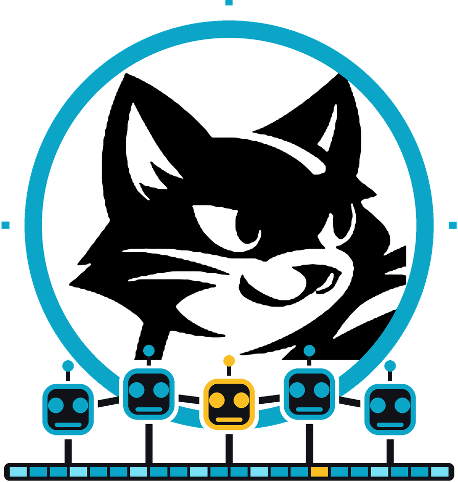

# Felix Agents

A swarm of workers with [Felix](https://github.com/GetFelix/felix) as its only
backend.

A planner fans work out as tasks, many workers claim them, and results flow
back. Workers join, leave and die mid-task, and the run carries on: Felix hands
each task to one worker and gives it to another when that worker stops
answering, holds the state they share, enforces who may write what, and keeps
every step in one durable log. You can watch the swarm in the browser, with
tasks travelling to workers and results coming back, and scrub back to any
moment of the run.

In the headline demo the workers are AI agents reviewing a pull request. They
reach Felix through an MCP server, so any MCP host can take part without Felix
code of its own.

> **Status:** design stage. Nothing runs yet. The plan is in
> [docs/design.md](docs/design.md) and the work is tracked in
> [milestones](https://github.com/GetFelix/felix-agents/milestones).

## What it shows about Felix

[felix-arena](https://github.com/GetFelix/felix-arena) uses a log as a live feed
and a replay, [felix-metro](https://github.com/GetFelix/felix-metro) seeks back
through a long history, and [felix-blocks](https://github.com/GetFelix/felix-blocks)
is keyed state with many writers. Felix Agents uses all three for a swarm:

- **Each task is done once, even when workers die.** A consumer group hands a task to one worker and gives it to another when the first stops answering. A task that keeps failing is dead-lettered instead of retried forever.
- **Agents don't overwrite each other.** Shared findings and locks are conditional writes, so a stale write is refused and the agent sees what changed.
- **The run is a record you can replay.** Every claim, write, message, model call and refusal is on one log, in one order, with the broker's record of who wrote it.
- **Budgets hold under a race.** Spend goes through counters, reserved before each model call.
- **A prompt-injected agent stays in its lane.** Each agent has its own token. Whatever the model asks for, Felix refuses writes outside its grants, and the refusals are on the record.

## What you will be able to do

- Start a run with a goal, a budget and a team of agents, against a real model or scripted stand-ins
- Kill a worker mid-task and watch another pick its task up
- Watch a run live in the browser: tasks travelling to workers, results coming back, locks on the board, messages and the budget draining
- Scrub back to any moment of a run and open any step's prompt, response or tool output
- Plant a prompt injection in a task and watch Felix refuse what the agent tries
- Add Felix to Claude Code or another MCP host and join a run from there

## Felix features it uses

| Need | Felix feature |
|---|---|
| Handing each task to one worker | A consumer group: per-record ack, visibility timeout, claim extension |
| A task that never succeeds | Max attempts and dead letters |
| Shared findings | A log-backed cache with conditional writes (`cache_put_if`) |
| Locks | `cache_put_if` with a TTL, `cache_delete_if` |
| Who is alive | A cache with a TTL, expiry delivered to watchers |
| Agent to agent messages | A durable stream with the publisher recorded |
| Token and cost budgets | Counters |
| The record of a run | A durable stream, range reads, subscribe from an offset |
| What each agent may write | RBAC, down to a cache key prefix |
| The browser viewer | [felix-gateway](https://github.com/GetFelix/felix-gateway) |

Some of this is not yet reachable the way the design wants. The design lists
it under "Felix gaps", and each one has an issue labelled
[`felix-gap`](https://github.com/GetFelix/felix-agents/labels/felix-gap).

## How it works

Each agent runs `felix-mcp`, an MCP server holding that agent's own Felix
token. Its tools are Felix operations: claim a task, write the board, take a
lease, send a message, store an artifact. The model only acts through those
tools, so its grants are the agent's grants. A small runtime, `agents-run`,
calls the model, records spend with a separate token and keeps the agent's
heartbeat.

Everything an agent does is also written to the run's log, which has one shard
and so one order across all agents. The viewer reads that log through
felix-gateway, folds it into the state of the run at any offset, and follows it
live from there. Large prompts and outputs are stored once by hash and fetched
when you open a step. [docs/design.md](docs/design.md) has the details.

## Status

| M | Milestone | What it proves | State |
|---|---|---|---|
| 0 | The viewer, locked | The swarm reads well, at 8 workers and at 50, before Felix is involved | Planned |
| 1 | Tasks through Felix | One worker per task, even when workers die; poison tasks stop | Planned |
| 2 | Shared state | The board and locks never silently overwrite | Planned |
| 3 | Real models and budgets | A run never spends past its limit | Planned |
| 4 | Replay a run | Scrub to any moment, then follow live with no gap | Planned, needs range reads in the gateway client |
| 5 | Grants and the injection demo | An injected agent can only write where its token allows | Planned |
| 6 | Any host, at scale | Claude Code as an agent, 50 agents, broker loss | Planned |
| 7 | Self-hosting | Anyone can run it | Planned |

## Documentation

- [docs/design.md](docs/design.md): the design, data model and build order
- [Felix docs](https://docs.getfelix.dev/)

## Contributing

See [CONTRIBUTING.md](CONTRIBUTING.md).

## License

MIT. See [LICENSE](LICENSE).
