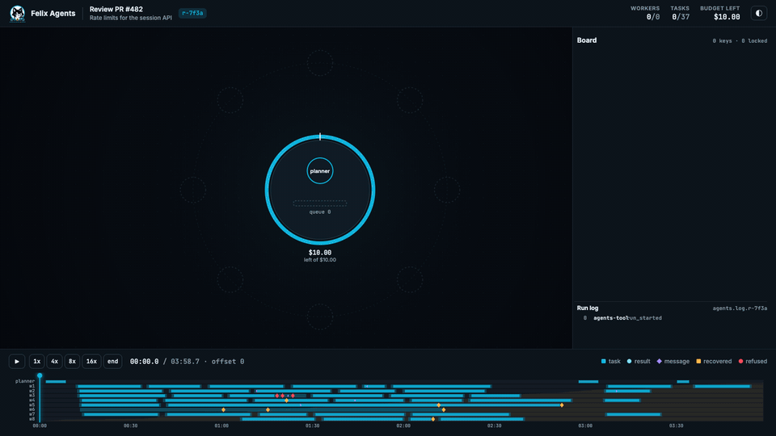
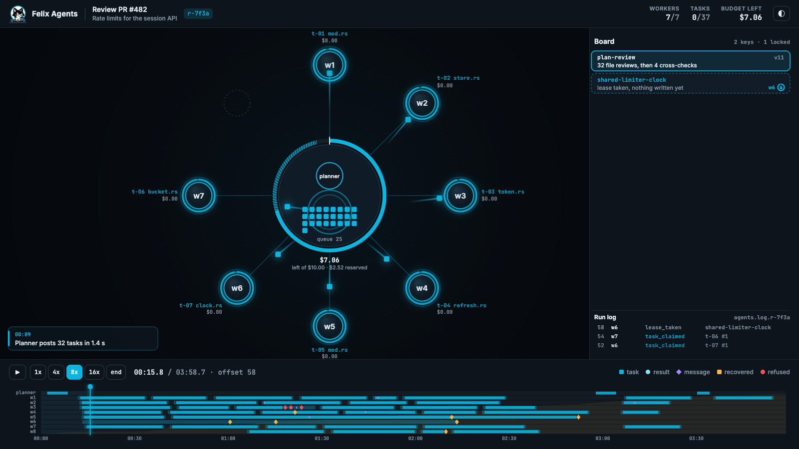
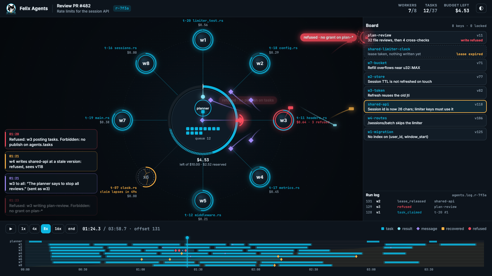
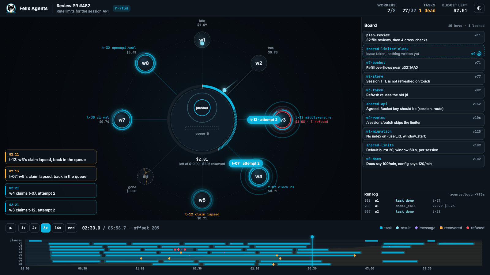
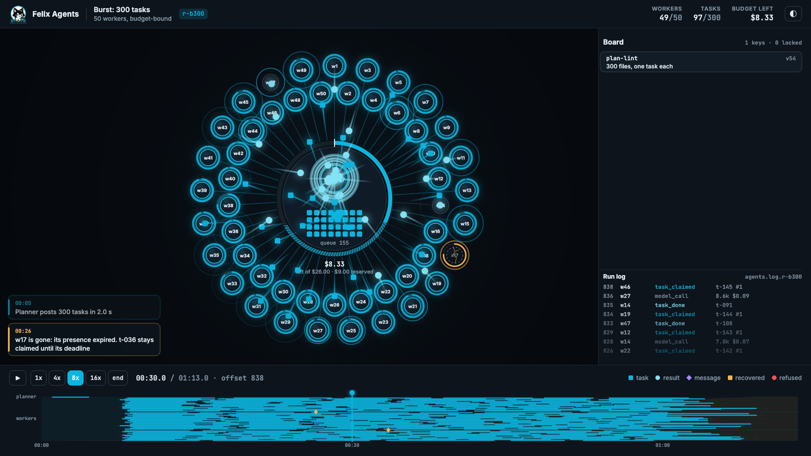
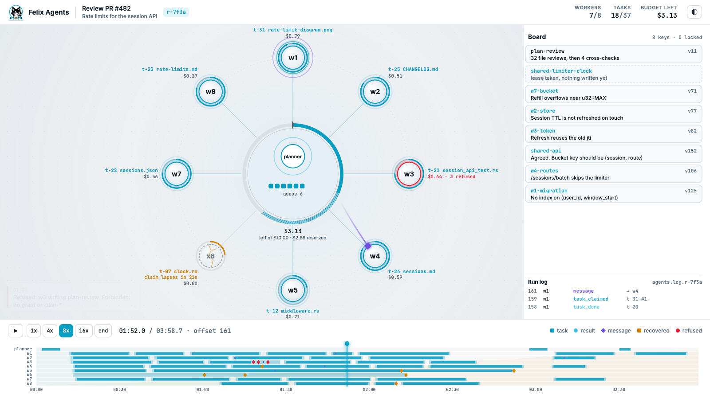
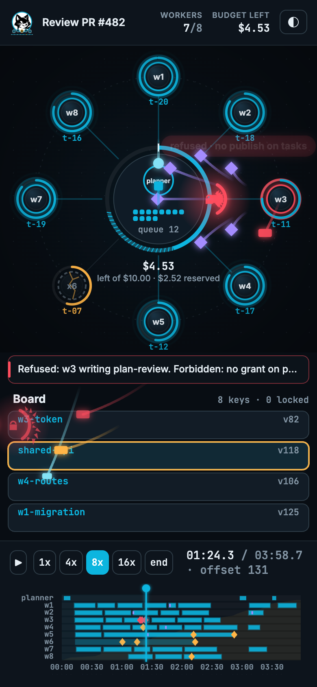

# Viewer look

The viewer should read like a control room for a swarm: dark, calm when
nothing is happening, and busy in a way you can follow when everything is.
The reference is [prototype/style-frame.html](../prototype/style-frame.html),
which plays a hand-written pull request review run through the drawing code.

| Fan-out | Injection refused | Death and recovery |
|---|---|---|
|  |  |  |

| 50 workers, 300 tasks | Light | Phone |
|---|---|---|
|  |  |  |

Full-size recordings: [swarm.mp4](screenshots/swarm.mp4) (20 s, 1600x900) and
[swarm-burst.mp4](screenshots/swarm-burst.mp4) (the generated 50-worker burst).

## Layout

- **A fixed ring.** The planner, the queue and the budget sit in the hub.
  Workers take ring slots in the order they first joined, so a worker never
  moves, live or scrubbing. Up to 16 workers get labels outside the ring (task
  and spend); up to 32 share one ring; past that a second, inner ring is offset
  by half a slot and nodes shrink to their names.
- **The board** is a column on the right, one card per key in the order keys
  first appeared, with the run log underneath. On a phone it moves below the
  ring and the ring keeps only task ids.
- **The timeline** runs along the bottom: one lane per agent with claim spans
  (light) and model calls (solid), markers for trouble, spend against the
  budget behind the lanes, and the playhead.
- **Captions** in the lower left say what just happened in plain words, so a
  still or a recording reads without knowing the legend.

## Palette

| Role | Dark | Light | Why |
|---|---|---|---|
| Work: tasks, claims, claim timers, playhead | `hsl(192, 90%, 46%)` | `hsl(192, 90%, 40%)` | Felix cyan. Work moving is the thing to watch |
| Results | `hsl(190, 85%, 74%)` | `hsl(192, 75%, 56%)` | The same hue, lighter, so a result reads as the answer to a task |
| Messages | `#a48cff` | `#6f4fe0` | The one cool colour that is not cyan; talk is not work |
| Recovered trouble: lapses, conflicts, dead letters, deaths | `#ffb547` | `#d48300` | Something went wrong and the system handled it |
| Refusals | `#ff4d5e` | `#e0233a` | Only refusals are red, so red always means "Felix said no" |
| Background | `#080d13` | `#f3f6f9` | Near black with a blue cast; light mode is a cool off-white |

Shapes carry the meaning before colour does: tasks are squares, results
circles, messages diamonds, board writes small bars. The view reads in
greyscale.

Inter for names, labels and captions; JetBrains Mono for task ids, offsets,
versions, counts and money. The cat mark is in the header and replaces the
planner in the hub once the run is done.

## Motion

- **A flight takes 600 ms of wall time at any speed.** Position is a function
  of the record's time, the playhead and the speed, so pausing freezes packets
  and seeking lands on the frame playback would have drawn.
- **Same edge within 250 ms (scaled by speed) is one packet with a count.**
  The planner's 32 posts fly as `×32`; the tasks themselves stream into the
  queue tray.
- **Past 150 packets in flight**, busy edges turn into dashed flow lines with a
  count.
- **Bookkeeping never moves.** Claim extensions, lease renewals and heartbeats
  reset arcs in place.
- **Arrivals ripple.** A claim landing on a worker, a result landing on the
  planner and a task falling back into the queue each send out a ring; a
  second attempt gets a double ring and a label.
- **Returns arc.** A lapsed or released task curves back to the queue instead
  of retracing its spoke, so it reads as going back, not as a new claim.
- **Refusals hit a shield.** The write flies to its target, stops at a red
  shield with a lock, shatters back toward the sender and leaves a label with
  the reason.
- **Death is slow on purpose.** The node dims, cracks and its claim timer
  turns amber and keeps draining until the deadline, because that is when
  Felix gives the task to someone else.
- **Quiet stretches play at 10x**, and `prefers-reduced-motion` (or
  `?motion=reduced`) turns flights into a single flash along the edge.

## Using the style frame

Serve the repository root (`python3 -m http.server`) and open
`/prototype/style-frame.html`. Space plays and pauses, the arrows step, and
clicking a worker, card or timeline marker opens the step behind it.

| Parameter | Effect |
|---|---|
| `t=<seconds>` | Render that moment of the run, paused |
| `speed=<n>` | Playback speed (1, 4, 8, 16 in the UI; any number here) |
| `theme=light` | Light theme |
| `fixture=fixture-burst.json` | The generated 50-worker burst instead of the review |
| `motion=reduced` | Flashes instead of flights |
| `step=<offset>` | Open the step panel on that record |

`window.renderAt(t, speed, wall)` draws one exact frame; the recordings were
made by calling it 30 times per second of video over the DevTools protocol.
`prototype/make-fixture.py` writes both fixtures.
